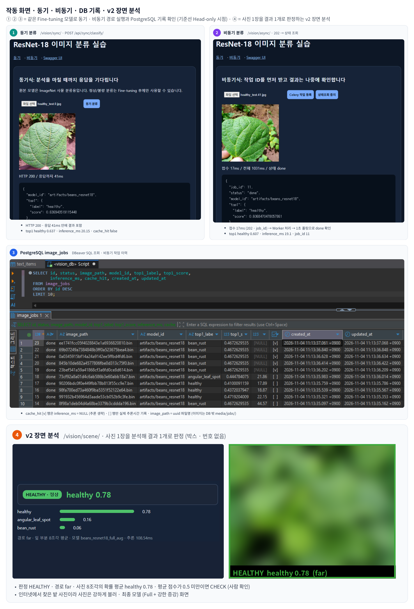
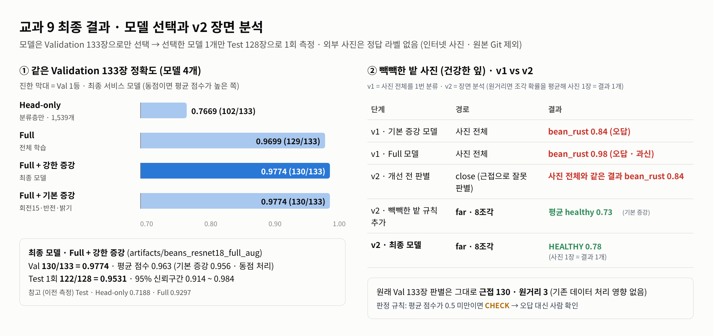
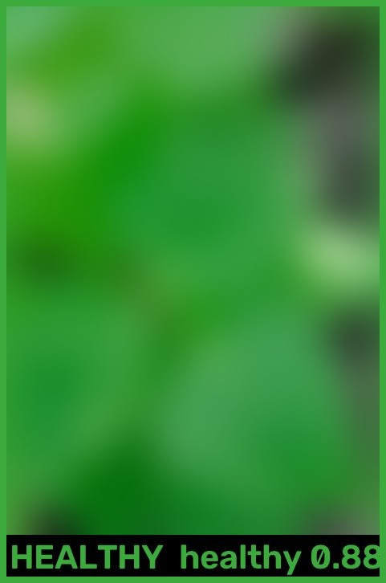

<div align="center">

# Bean Leaf Disease Classification Vision AI API

**ResNet-18 Fine-tuning · Sync / Async Serving · v2 Scene Analysis**

</div>

<p align="right"><a href="README.md">한국어</a> | <b>English</b></p>

<p align="center">
       <br>
       
</p>

## Project Overview

### Architecture

FastAPI only validates requests and returns responses; slow inference goes through the Redis broker and is handled by a Celery Worker. The same image with the same model is returned straight from the Redis cache, and the status and result of async jobs are stored in PostgreSQL. The orange box below, **v2 Scene Analysis**, checks photo quality first and **automatically tells close-up from distant shots**. For a distant shot, it cuts the photo into several tiles, classifies each with the same final model, then **averages the probabilities to give one result per photo**. All 4 services start with a single **Docker Compose** command.


*The diagram is in Korean.* Component roles · runtime → [02 System Architecture (Korean)](reports/02_시스템_아키텍처.md) · Code flow after a button click → [05 Processing Flow (Korean)](reports/05_AI버튼_처리흐름.md)

<br>

### Summary

This is the evaluation project for Subject 9. It is an image classification service that sorts bean leaf photos into **3 classes: angular leaf spot (angular_leaf_spot) · bean rust (bean_rust) · healthy (healthy)**. I replaced the 1,000-class ImageNet output layer of Hugging Face `microsoft/resnet-18` with **3 outputs and fine-tuned it**, then connected the trained model to a **FastAPI sync API and a Celery async job queue**. Redis caching and PostgreSQL job history all run together with Docker Compose. I analyzed the results, found 5 problems (accuracy · suspected leakage · photos outside the dataset · dense field photos · model choice), and took each through root-cause analysis → improvement → re-validation. I added **v2 Scene Analysis**, which automatically splits leaves in distant field photos before judging, and compared 4 models on the same Validation set to choose the **Full + Strong Augmentation model (Test 0.9531)** as the final service model.

<br>

### Results

With Train **1,034 images** · Validation **133 images**, I first built the baseline required by the evaluation, Head-only Fine-tuning (**Validation 0.7669**), and connected it to the service. The sync API returns the result right away with **HTTP 200**; the async API accepts the request with **202 + job_id**, a Celery Worker processes it, and PostgreSQL records it as `done`. All **19 real-environment feature · failure tests passed**.

After analyzing the results, I trained Full Fine-tuning and 2 augmentation variants with the same code, and chose the final model by **comparing on the same 133 Validation images only**.

| Model (presentation name) | Trained part | Parameters | Validation 133 (epoch 1 → 2 → 3) | Best Validation | Test 128 (once, after selection) |
|---|---|---:|---|---:|---:|
| **Baseline** · Head-only Fine-tuning | classifier only | 1,539 | 0.6617 → 0.7669 → 0.7669 | 0.7669 (102/133) | 0.7188 (92/128) |
| **1st improvement** · Full Fine-tuning | Backbone + classifier | 11,178,051 | 0.9323 → 0.9474 → 0.9699 | 0.9699 (129/133) | 0.9297 (119/128) |
| **2nd improvement (Final)** · Full + Strong Augmentation | All + strong augmentation<br><sub>(zoom · crop · rotate 25° · horizontal flip · brightness · contrast · saturation · blur)</sub> | 11,178,051 | 0.8045 → 0.9398 → 0.9774 | **0.9774 (130/133)** | **0.9531 (122/128)** |
| Comparison model · Full + Basic Augmentation | All + basic augmentation<br><sub>(rotate 15° · horizontal flip · brightness)</sub> | 11,178,051 | 0.9323 → 0.9774 → 0.9774 | 0.9774 (130/133) | — (not selected) |

- **Shared training settings** · epoch **3** (all 1,034 Train images, 3 passes) · batch **8** (8 images at a time) · learning rate **0.0002** · AdamW · seed **42** · the model with the highest Validation accuracy is saved after each epoch
- Parentheses = correct / total · e.g. (130/133) = 130 of 133 Validation images correct · augmentation is applied to Train images only (Validation · Test unchanged)

**How the final service model was chosen**

- **Selected by Validation only** — the two augmentation models tied at 130/133, so I chose strong augmentation for its higher average score (0.963 vs 0.956). Choosing by Test would be data leakage, so Test was measured only once, after the choice was made (95% confidence interval 0.914 ~ 0.984).
- **Switching takes one line** — `MODEL_PATH=artifacts/beans_resnet18_full_aug` in `.env` · the cache key includes the model path, so old cache entries never mix in. It is the same ResNet18 architecture, so response time matches the Head-only measurements → [08 6-5 (Korean)](reports/08_최종기술보고서.md#6-5-p5--증강-실험--최종-모델-선택)

<br>

### Problem Analysis · Improvements

| Problem | Cause | Improvement | Result |
|---|---|---|---|
| Low service-model accuracy · two diseases confused | Underfitting (only 1,539 classifier weights trained · Train also 0.774) | Full Fine-tuning | Test **0.7188 → 0.9297** |
| Score jump so large that leakage was suspected | Only one check (md5) | 5 detailed leakage checks · re-scoring every photo | Leakage **0** · gain holds even on the least similar photos |
| Healthy leaves in field photos classified as diseased | Domain gap (trained on one close-up leaf vs distant shot with many leaves) | v2 Scene Analysis · automatic close-up / distant detection · tile probability averaging · CHECK | Original val **130 / 133 close-up** · field photo **HEALTHY 0.88** · blurry photo **RETAKE** |
| Dense field photo misjudged as close-up → bean_rust 0.84 | Rule was "at least 1 large leaf" · when small leaves cover the frame, there are 0 large leaves | Dense-field rule (leaf area ≥ 60% · ≥ 8 small leaves filling the frame → distant) | Distant · 8-tile average → **HEALTHY 0.78** · original val detection unchanged at 130 / 133 |
| Same photo, different scores per person · final model undecided | Different augmentation methods · service model still the baseline | Trained 2 augmentation variants · compared 4 models on the same Validation | Final **Full + Strong Augmentation** · Val 0.9774 · Test **0.9531** |

Full record of build → result → analysis → problem → cause → improvement → result → [08 Final Technical Report, Chapter 6 (Korean)](reports/08_최종기술보고서.md#6-문제-분석--개선)

<br>

### Impact

The async design **separates accepting a request from processing it**, cutting the HTTP response from sync 21.1 ms → **10.0 ms (52.6% less)**, and a Redis cache HIT skips inference and responds in **1.8 ms (91.5% less)**. Inference itself is about 20 ms on both paths.

| Key metric | Result |
|---|---|
| Classification target | Bean leaf **3 classes** · 1 image → 1 label + score |
| Training | Validation Head-only **0.7669** → Full **0.9699** → final Full + Strong Augmentation **0.9774** · **final Test 128 images 0.9531** · leakage checks 0 |
| Runtime structure | Docker Compose **4 services** · web · worker · redis · postgres |
| Response time | Sync 21.1 ms · async accept **10.0 ms** · cache HIT **1.8 ms** (median of 5) |
| Validation | Real environment **19 PASS** · v2 Scene Analysis 4 · automated tests **10 passed** · 503 and failed record on outage |
| Field readiness | v2 · automatic close-up / distant detection (val 97.7%) · dense fields treated as distant · 1 photo = 1 result (tile probability average) · CHECK when unsure · RETAKE when blurry |

Evidence → [06 Performance Comparison (Korean)](reports/06_성능비교_보고서.md) · [07 Feature Tests (Korean)](reports/07_기능테스트_오류분석.md)

<br>

### Working Screens



*① Sync returns the result inside the response; ② async accepts with 202, then polls the status every second until done. ③ Async results are stored in PostgreSQL `image_jobs`; cache HIT rows have NULL inference time. ④ v2 Scene Analysis shows one result per photo (verdict · label · score) (internet photos are blurred). The UI is in Korean.*
All captures → [Evidence index (Korean)](reports/evidence/00_INDEX.md)

<br>

### Key Result Charts



*① 4 models compared on the same 133 Validation images → Full + Strong Augmentation chosen as final (Test once: 0.9531) · ② the dense field photo is judged as one result per photo by averaging tile probabilities in v2 Scene Analysis*


*Async separates accepting from processing: HTTP response 10.0 ms · cache HIT skips inference: 1.8 ms · raw data → [timings.csv](reports/data/timings.csv)*

<br>

### Deliverables

All reports are written in Korean.

| No. | Deliverable | Focus |
|---|---|---|
| 01 | [Fine-tuning Results Report](reports/01_FineTuning_결과보고서.md) | Data mapping · training settings · Head-only vs Full |
| 02 | [System Architecture](reports/02_시스템_아키텍처.md) | Diagram · roles · runtime |
| 03 | [API Specification](reports/03_API_명세서.md) | URL · Method · response · status codes |
| 04 | [DB Structure · Job History](reports/04_DB_구조_작업이력.md) | image_jobs · real history · failed rows |
| 05 | [AI Button Processing Flow](reports/05_AI버튼_처리흐름.md) | Sync · async sequence · code map |
| 06 | [Performance Comparison Report](reports/06_성능비교_보고서.md) | HTTP · completion · inference · cache |
| 07 | [Feature Tests · Error Analysis](reports/07_기능테스트_오류분석.md) | 23 cases · error history · misclassifications |
| 08 | [Final Technical Report](reports/08_최종기술보고서.md) | Summary · final model choice · 5 problems: cause analysis → improvement → re-validation · design reasons · limits · conclusion |

More: [Final result figure](reports/evidence/v2_final_result.png) · [4-model comparison · final Test](reports/data/final_models.json) · [External photos v1 vs v2](reports/data/v2_external.json) · [Leakage check](reports/analysis/summary.json) · [v2 results](reports/data/v2_far_original.json) · [Test metrics](reports/data/test_metrics.json) · [Robustness test](reports/figures/robust_sheet.jpg) · [Performance chart](reports/figures/perf_compare.png) · [Architecture](reports/figures/architecture.png) · [WBS](reports/figures/wbs_schedule.png) · [Evidence index](reports/evidence/00_INDEX.md) · `perf.py` · `perf_chart.py`

<br>

### Developer

| Name | Role | Responsibilities | Main deliverables |
|---|---|---|---|
| Sung&nbsp;Hyung&nbsp;Lee | Solo developer · AI serving | Data prep · Fine-tuning · augmentation experiments · model selection · FastAPI / Celery / Redis / PostgreSQL serving · performance · failure testing · leakage checks · v2 Scene Analysis · documentation | Deliverables 01 ~ 08 · README · performance charts · evidence captures |

<br>

### Quick Links

| Purpose | Link |
|---|---|
| First run | [Quick Start](#quick-start) → [6. Run · Check](#run-check) |
| Results · evidence | [08 Final Technical Report (Korean)](reports/08_최종기술보고서.md) · [Problem Analysis · Improvements](#problem-analysis--improvements) · [Key Result Charts](#key-result-charts) · [8. Performance](#perf) · [9. Verification](#verify) |
| Structure · deliverables | [Architecture](#architecture) · [Deliverables](#deliverables) · [2. Folder Structure](#folders) · [10. WBS Schedule](#wbs) |
| Troubleshooting | [11. Notes](#caution) |

<br><br>

<a id="quick-start"></a>

## Quick Start

You need: Windows 11 + WSL2 Ubuntu + **Docker Desktop** (Settings → Resources → WSL integration → turn on Ubuntu). An NVIDIA GPU makes training faster; without one, training runs on CPU.

**Step 1 · Clone · install** — in the Ubuntu window

```bash
sudo apt update && sudo apt install -y git unzip python3-venv
git clone https://github.com/sunghyunglee6334-web/fastapi-beans-resnet18-project.git ~/fastapi_resnet18
cd ~/fastapi_resnet18
python3 -m venv .venv && source .venv/bin/activate
python -m pip install -r requirements.txt
```

**Step 2 · Data · training** — download the Beans data, place `validation` as `val`, and train Head-only

```bash
mkdir -p ~/beans_source
for s in train validation test; do curl -L -o /tmp/$s.zip https://huggingface.co/datasets/AI-Lab-Makerere/beans/resolve/main/data/$s.zip && unzip -q -o /tmp/$s.zip -d ~/beans_source; done
mkdir -p dataset && cp -r ~/beans_source/train dataset/train && cp -r ~/beans_source/validation dataset/val && cp -r ~/beans_source/test dataset/test
python -m training.finetune --data dataset --output artifacts/beans_resnet18 --epochs 3 --batch-size 8 --freeze-backbone
```

It is done when you see `저장 완료: artifacts/beans_resnet18 / best val accuracy=…` ("saved"). Build the final service model (Full + Strong Augmentation) with the command below, and check the 4-model comparison · selection · one-time Test with `python tools/final_check.py`.

```bash
python -m training.finetune --data dataset --output artifacts/beans_resnet18_full_aug --epochs 3 --batch-size 8 --augment --aug-mode strong
```

**Step 3 · Run** — start Redis · PostgreSQL · FastAPI · Celery Worker together

```bash
cp .env.example .env
docker compose up -d --build
docker compose ps
```

When all 4 services show `Up`, upload a bean leaf photo at http://127.0.0.1:8000/vision/sync/. For photos with many leaves, like field shots, use http://127.0.0.1:8000/vision/scene/.

<br><br>

<a id="features"></a>
<details>
<summary><b>1. Main Features</b> — training · sync · async · cache · DB · error handling · v2 Scene Analysis · model comparison</summary>

| Feature | Screen · API | Evidence |
|---|---|---|
| Bean leaf 3-class Fine-tuning · model saving · augmentation (`--augment --aug-mode strong / basic`) | `training/finetune.py` → `artifacts/beans_resnet18*` | [01](reports/01_FineTuning_결과보고서.md) |
| 4-model Validation comparison · final choice · Test once | `tools/final_check.py` → `reports/data/final_models.json` | [08](reports/08_최종기술보고서.md#6-5-p5--증강-실험--최종-모델-선택) |
| Sync classification · result returned immediately (200) | `/vision/sync/` · `POST /api/sync/classify/` | [03](reports/03_API_명세서.md) |
| Async accept (202 + job_id) · status lookup | `/vision/async/` · `POST /api/async/classify/` · `GET /api/async/jobs/{job_id}/` | [03](reports/03_API_명세서.md) · [05](reports/05_AI버튼_처리흐름.md) |
| Redis result cache · TTL 600 s | `ai/cache_service.py` | [06](reports/06_성능비교_보고서.md) |
| Job status · result storage | PostgreSQL `image_jobs` | [04](reports/04_DB_구조_작업이력.md) |
| Input validation · error responses | 400 format · 413 size · 422 missing · 404 · 503 | [07](reports/07_기능테스트_오류분석.md) |
| v2 Scene Analysis · automatic close-up / distant detection · tile probability averaging · 1 photo = 1 result · CHECK · RETAKE | `/vision/scene/` · `POST /api/v2/classify/` | [08](reports/08_최종기술보고서.md#6-3-p3--데이터셋-밖-밭-사진-오분류) |
| Data leakage check · re-scoring | `leak_check.py` → `reports/analysis/` | [08](reports/08_최종기술보고서.md#6-2-p2--점수-상승폭이-커서-데이터-누수-의심) |
| API docs | `/docs` Swagger | [swagger](reports/evidence/swagger.png) |

</details>

<a id="folders"></a>
<details>
<summary><b>2. Folder Structure</b> — serving code · training · tools · tests · deliverables</summary>

```text
fastapi_resnet18/
│
├── main.py                 ← FastAPI app · DB init · router wiring
├── compose.yaml            ← web · worker · redis · postgres (4 services)
├── Dockerfile              ← shared web · worker image (python 3.11 · CPU torch)
├── requirements.txt
├── .env.example            ← MODEL_PATH sample (.env is excluded from Git)
│
├── ai/                     ← serving code
│   ├── router_sync.py      ← sync API
│   ├── router_async.py     ← async accept · status API
│   ├── router_v2.py        ← v2 Scene Analysis API · screen
│   ├── scene_service.py    ← tile probability averaging · per-photo verdict (DISEASE · CHECK · HEALTHY · RETAKE)
│   ├── leaf_router.py      ← quality gate · close-up / distant detection · tile positions (OpenCV) · result image (no boxes)
│   ├── cache_service.py    ← Redis cache HIT / MISS
│   ├── services.py         ← image validation · classification
│   ├── hf_model.py         ← load model once · reuse
│   ├── tasks.py            ← Celery Worker task
│   └── models.py           ← image_jobs table
│
├── training/finetune.py    ← ResNet18 3-class Fine-tuning · --augment --aug-mode strong / basic
├── templates/ · static/    ← sync · async · v2 Scene Analysis screens
├── tests/                  ← 10 automated tests (API · v2 Scene Analysis)
├── tools/scene_preview.py  ← check close-up / distant detection for a folder
├── tools/final_check.py    ← 4-model Val comparison · final choice · Test once · external photos v1 vs v2
├── leak_check.py           ← data leakage check · re-score every photo
├── perf.py · perf_chart.py ← performance measurement · chart
├── robust_test.py          ← Test 128 accuracy · robustness test
├── make_variants.py        ← generate 19 variants of a new photo
├── robust/variants/        ← robustness test input photos
│
└── reports/                ← evaluation deliverables 01 ~ 08 (Korean)
    ├── analysis/           ← leakage check · re-scoring results (json · csv)
    ├── data/               ← timings.csv · training_report · test_metrics · v2 results
    ├── figures/            ← Architecture · WBS · performance chart
    └── evidence/           ← run · error test captures
```

Excluded from Git: `.env` · `.venv/` · `dataset/` · `artifacts/` (weights) · `media/jobs/` → rebuild them with the [Quick Start](#quick-start) steps.

</details>

<a id="env"></a>
<details>
<summary><b>3. Runtime Environment</b> — WSL2 · GPU training · Docker Compose serving · ports</summary>

| Item | Environment |
|---|---|
| OS | Windows 11 + WSL2 Ubuntu |
| Training | WSL `.venv` · GPU (`torch.cuda.is_available()` = True) |
| Serving | Docker Compose · redis:7.4-alpine · postgres:17-alpine · web / worker = python:3.11-slim (CPU) |
| Ports | 8000 web · 6379 redis · 5432 postgres (127.0.0.1 only) |
| Worker | Celery `--pool=solo --concurrency=1` |

</details>

<a id="data"></a>
<details>
<summary><b>4. Data Preparation</b> — Train 1,034 · Validation 133 · Test 128</summary>

| Source (Hugging Face `AI-Lab-Makerere/beans`) | Used as | Images | Purpose |
|---|---|---:|---|
| `train/` | `dataset/train/` | 1,035 | Training (1 non-image file removed → 1,034) |
| `validation/` | `dataset/val/` | 133 | Validation during training · best model selection |
| `test/` | `dataset/test/` | 128 | Not used in training · demo input |

Classes are about 1 : 1 : 1 · identical files across splits: **0** (md5) · originals kept, runs use copies → [01 Fine-tuning, Chapter 1 (Korean)](reports/01_FineTuning_결과보고서.md)

</details>

<a id="train"></a>
<details>
<summary><b>5. Model Training</b> — Head-only → Full → augmentation · final model · leakage check · robustness · v2 results</summary>

| Experiment | Trained part | Saved to | Validation | Test |
|---|---|---|---:|---:|
| Head-only (required · baseline) | classifier head only (`--freeze-backbone`) | `artifacts/beans_resnet18` | 0.7669 | 0.7188 |
| Full Fine-tuning | all weights | `artifacts/beans_resnet18_full` | 0.9699 | 0.9297 |
| **Full + Strong Augmentation (final · service)** | all · `--augment --aug-mode strong` | `artifacts/beans_resnet18_full_aug` | **0.9774** | **0.9531** |
| Full + Basic Augmentation | all · `--augment --aug-mode basic` | `artifacts/beans_resnet18_full_aug_basic` | 0.9774 | — |

Augmentation is applied to Train only; Validation is left unchanged (strong = zoom · crop · rotate 25° · brightness · contrast · saturation · blur / basic = rotate 15° · horizontal flip · brightness). The final choice is the Validation winner (average score breaks ties), and Test was measured once after the choice → [final_models.json](reports/data/final_models.json)

→ Chart: [Key Result Charts](#key-result-charts)

Head-only reaches only 0.774 even on Train, so it is **underfitting** (only 1,539 classifier weights trained). Its biggest weakness is bean_rust recall 0.535 (13 bean_rust images misclassified as angular_leaf_spot) → [01 Fine-tuning, Chapter 8 (Korean)](reports/01_FineTuning_결과보고서.md) · [test_metrics.json](reports/data/test_metrics.json)

Shared settings: epochs 3 · batch 8 · lr 0.0002 · AdamW · seed 42 · output layer 1,000 → 3 · training logs → [training_report Head-only](reports/data/training_report_headonly.json) · [Full](reports/data/training_report_full.json)

<br>

#### Data Leakage Check

The Head-only → Full gain (+21.1%p) was large, so I re-checked using all 1,295 photos. Exact md5 duplicates **0** · near-identical pHash photos **0** · ImageNet feature similarity ≥ 0.95 **0 images** · lines in the training code that use test **0**. Even on the Test subset least similar to train, Full still led 0.844 vs 0.688, so I concluded the gain is **a real learning effect, not leakage** → [08 6-2 (Korean)](reports/08_최종기술보고서.md#6-2-p2--점수-상승폭이-커서-데이터-누수-의심) · [summary.json](reports/analysis/summary.json)

<br>

#### Robustness Test on Photos Outside the Dataset

I tested both models with 19 variants of a bean field photo (healthy leaves) I found myself, adding synthetic disease, photo effects and geometric changes. Both models misclassified even the healthy original as bean_rust, and Full gave wrong answers with scores of 0.99 or higher under blur · darkening · JPEG. This confirmed the limit that **Test performance is not guaranteed when the shooting conditions differ from the training data (one close-up leaf)**, which I then improved with v2 Scene Analysis.


Results and interpretation per variant → [07 Chapter 5 (Korean)](reports/07_기능테스트_오류분석.md) · raw data → [robust_results.csv](reports/data/robust_results.csv)

<br>

#### v2 Scene Analysis · Improvement Results

Each photo goes through **quality gate → automatic close-up / distant detection → classification → 1 photo = 1 result**. A close-up photo is classified whole, as before; a distant photo is cut into several tiles, each classified with the same model, and the **probabilities are averaged**. If the average score is below 0.5, the photo goes to CHECK instead of returning a wrong answer. This is a classification project, so no boxes or numbers are drawn. Detection thresholds were tuned on Validation (close-up 113 → **130 / 133**).



| Input | v1 whole photo once (Head-only) | v2 · at Head-only stage | **v2 · final model** |
|---|---|---|---|
| Field photo (healthy leaves) | bean_rust 0.42 (wrong) | Distant · 6 tiles · 0.37 ~ 0.45 → CHECK | Distant · 7-tile average → **HEALTHY 0.88** |
| Healthy leaf from original Test | healthy | Close-up → HEALTHY 0.64 | Close-up → **HEALTHY 0.99** |
| Blurry photo | angular_leaf_spot 0.42 | RETAKE | **RETAKE** |
| Dense field photo (internet · numbers only) | bean_rust 0.84 (basic aug.) · 0.98 (Full) (wrong) | Wrongly detected as close-up | Distant · 8-tile average → **HEALTHY 0.78** |

Because the verdict uses the average over the whole photo, a single low-scoring tile no longer decides it: the field photo that the old rule over-warned as DISEASE is now **HEALTHY 0.88**. On the 133 Validation images, v2 gives **the same result as v1 (whole photo) on 133 / 133** (accuracy 0.9774 · `tools/v2_check.py`). The screen shows one verdict card and score bars for the 3 classes, and the photo is blurred with no boxes → [08 6-3 (Korean)](reports/08_최종기술보고서.md#6-3-p3--데이터셋-밖-밭-사진-오분류).

Step-by-step method · threshold tuning · limits → [08 6-3 (Korean)](reports/08_최종기술보고서.md#6-3-p3--데이터셋-밖-밭-사진-오분류)

</details>

<a id="run-check"></a>
<details>
<summary><b>6. Run · Check</b> — expected response per URL · tests · switching models</summary>

| URL | Expected response |
|---|---|
| http://127.0.0.1:8000/health | `{"status":"ok"}` |
| http://127.0.0.1:8000/vision/sync/ | HTTP 200 · `top1` · `all` · `inference_ms` · `cache_hit` |
| http://127.0.0.1:8000/vision/async/ | 202 · `job_id` → status lookup `status: done` |
| http://127.0.0.1:8000/vision/scene/ | Verdict (DISEASE · CHECK · HEALTHY · RETAKE) · path (close · far) · label · score (no boxes) |
| http://127.0.0.1:8000/docs | Swagger API docs |

- Changing the model · `MODEL_PATH` → `docker compose up -d --force-recreate web worker`
- Automated tests → `docker compose exec web python -m pytest -q` (10 tests)
- Model comparison · final choice · Test once → `python tools/final_check.py` (WSL `.venv`)
- Check close-up / distant detection → `python tools/scene_preview.py dataset/val`
- Stop → `docker compose stop`

</details>

<a id="api-db"></a>
<details>
<summary><b>7. API · DB</b> — 4 APIs · image_jobs table</summary>

| API | Method | Success | Failure |
|---|---|---|---|
| `/api/sync/classify/` | POST · `image` | 200 result | 400 · 413 · 422 |
| `/api/async/classify/` | POST · `image` | 202 accepted | 400 · 413 · 422 · 503 |
| `/api/async/jobs/{job_id}/` | GET | 200 status · result | 404 |
| `/api/v2/classify/` | POST · `image` · `draw` | 200 verdict · path · label · score | 400 · 413 · 422 |

A single `image_jobs` table stores each async job's status (`queued → running → done / failed`) · result · inference time · cache flag. Images are saved to `media/jobs/<uuid>.bin`, not in the DB → [03 API (Korean)](reports/03_API_명세서.md) · [04 DB (Korean)](reports/04_DB_구조_작업이력.md)

</details>

<a id="perf"></a>
<details>
<summary><b>8. Performance Comparison</b> — sync · async · cache response time</summary>

| Item (median of 5) | Sync | Async |
|---|---:|---:|
| MISS HTTP response | 21.1 ms | 10.0 ms (accept) |
| MISS time to final result | 21.1 ms | 221.9 ms (includes 0.2 s polling) |
| Actual inference inference_ms | 15.35 ms | 21.86 ms |
| HIT HTTP response | 1.8 ms | 7.4 ms (accept) |

Async is faster **because accepting and processing are separated**, not because inference got faster. `inference_ms = null` on a cache HIT means inference was skipped → [06 Performance Comparison (Korean)](reports/06_성능비교_보고서.md) · [raw CSV](reports/data/timings.csv) · chart → [Key Result Charts](#key-result-charts)

</details>

<a id="verify"></a>
<details>
<summary><b>9. Verification Results</b> — real environment · errors · outages · automated tests · model choice · v2</summary>

| Area | Result |
|---|---|
| Normal features | Sync 3 classes · async 202 → done · DB records · cache HIT / MISS · TTL expiry confirmed |
| Input errors | 400 format · 413 over 5 MB · 422 missing file · 404 unknown job |
| Outage · recovery | Worker stopped → waits in queued → done after restart · Redis stopped → async 503 + failed record · sync infers without cache · normal after recovery |
| Automated tests | `pytest` inside Docker **10 passed** · 4 API + 6 v2 Scene Analysis (incl. dense-field detection · fake model · separate from real environment) |
| Model choice | 4 models compared on the same 133 Val images → Full + Strong Augmentation 0.9774 chosen → Test once **0.9531** |
| Leakage check | md5 · pHash · feature similarity · training code · distribution → leakage 0 · re-scored values identical |
| Robustness | 1 bean leaf photo outside the dataset (collected from the internet myself) × 19 variants (synthetic disease · blur · noise · brightness · rotation · occlusion) → both models wrong from the original onward · domain gap confirmed |
| v2 Scene Analysis (final model) | val close-up detection 130 / 133 · same result as v1 on val 133 / 133 · field photo distant 7 tiles → HEALTHY 0.88 · healthy Test leaf → HEALTHY 0.99 · blurry photo → RETAKE · dense field → distant 8 tiles → HEALTHY 0.78 |

23 cases in total (19 basic + 4 v2) · error history → [07 Feature Tests · Error Analysis (Korean)](reports/07_기능테스트_오류분석.md)

</details>

<a id="wbs"></a>
<details>
<summary><b>10. WBS Schedule</b> — study period · tasks · presentation</summary>

Monday and Tuesday were the Subject 9 study period for Vision · FastAPI · Redis · Celery; the evaluation work ran from Wednesday to Thursday morning, with the presentation on Thursday afternoon.


</details>

<a id="caution"></a>
<details>
<summary><b>11. Notes</b> — <code>.env</code> · data · models excluded from Git · do not delete volumes · switching models · external photos · limits</summary>

- `.env` and passwords are never pushed to Git (only `.env.example` is shared)
- The dataset and trained weights are too large, so they are excluded from Git → rebuild them with [Quick Start](#quick-start) Step 2
- Do not use `docker compose down -v`; it deletes the PostgreSQL · Redis volumes (use `docker compose stop` to stop)
- After changing the model, recreate both web and worker (each process loads its own model) · final service model: `MODEL_PATH=artifacts/beans_resnet18_full_aug`
- External (internet) photos have no ground-truth labels, so no accuracy was calculated for them · the original photos are not in Git due to copyright; only the result numbers are kept
- For photos taken in conditions different from the training data (fields · soil background), use v2 Scene Analysis (`/vision/scene/`) · accuracy depends on the classifier, and an unclear average score is shown as CHECK → [08 6-3 (Korean)](reports/08_최종기술보고서.md#6-3-p3--데이터셋-밖-밭-사진-오분류)
- v2 close-up / distant detection and tile positions are OpenCV rule-based, so detection can be wrong on low-resolution or noisy photos · HSV lesion-area ratio and CNN + ML fusion are design proposals → [08 Final Technical Report, Chapter 7 (Korean)](reports/08_최종기술보고서.md#7-교과-9-opencv-기반-개선-상태)

</details>
